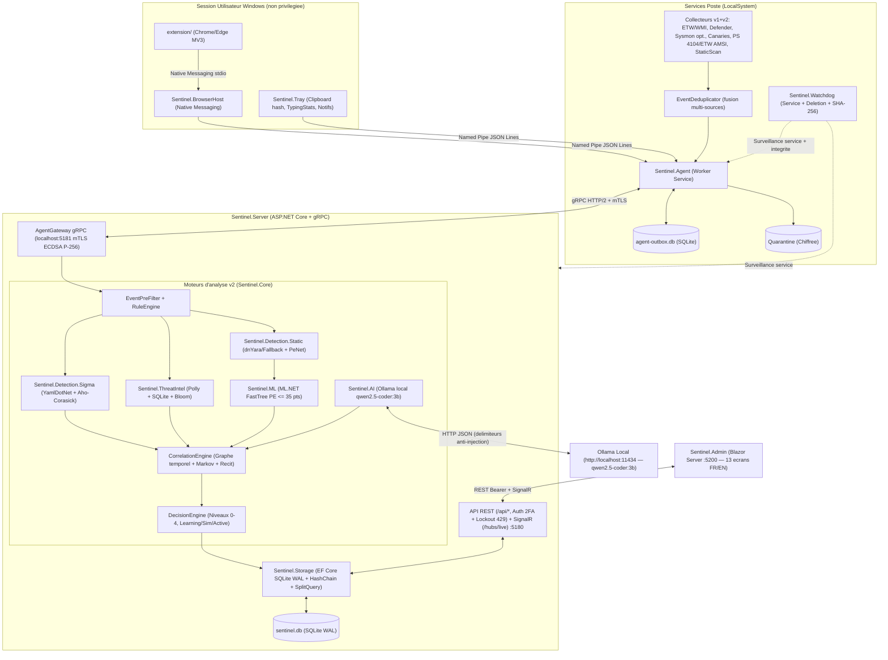

# Architecture technique de SENTINEL v2

> Référence d'architecture (.NET 10 LTS — **21 projets** dans `Sentinel.slnx`) synchronisée avec l'implémentation effective de **SENTINEL v2.0.0**.

---

## 1. Vue d'ensemble et principes architecturaux

**SENTINEL v2** est un EDR léger Windows en **défense en profondeur** qui complète Microsoft Defender en combinant télémétrie système/Defender/Sysmon, moteurs de détection locaux (règles déterministes, **Sigma**, **YARA**, **analyse statique PE**, **Threat Intelligence SQLite+Bloom**, **ML.NET FastTree**, **fichiers canaris**, **visibilité PowerShell 4104**), **corrélation contextuelle Markovienne** et **IA 100 % locale (Ollama)**.

### Invariants architecturaux non négociables

1. **Séparation des privilèges** : collecte bas niveau et exécution d'actions réversibles en service `LocalSystem` (`Sentinel.Agent`), composants interactifs en session utilisateur (`Sentinel.Tray`, `Sentinel.BrowserHost`), analyse et persistance dans `Sentinel.Server`, console Web sans privilège système (`Sentinel.Admin`).
2. **Décision 100 % déterministe** : le LLM local (`Ollama`) et le classifieur ML PE (contribution plafonnée ≤ 35/100) ne déclenchent **jamais** d'action directe ; toute réponse passe par `DecisionEngine` et produit un ticket d'action réversible.
3. **Confidentialité dès la conception** : métadonnées uniquement (hash, domaine, entropie, statistiques de cadence), aucune donnée envoyée vers un cloud (hors téléchargements entrants opt-in de flux de renseignement publics ou lookup hash explicite VirusTotal).
4. **Résilience hors-ligne et intégrité** : outbox SQLite côté agent, base Threat Intel SQLite locale hors-ligne, chaînes de hachage SHA-256 sur `Events` et `AuditEntries`, durcissement NTFS `SYSTEM + Administrateurs`, Watchdog surveillant arrêts, suppressions de services et altérations binaires.

---

## 2. Diagramme d'architecture globale v2

---

## 3. Cartographie complète des 21 projets (`Sentinel.slnx`)

| Projet | Cible / Type | Rôle et responsabilités |
|---|---|---|
| `src/Sentinel.Shared` | `net10.0` (lib) | Contrats partagés : modèles (`SecurityEvent`, `ThreatAssessment`, `ScoreContribution`, `CorrelationCluster` enrichi, `AnalystFeedback` réversible), `MitreCatalog`, routes/DTOs v1+v2, Protobuf gRPC, IPC Named Pipe, PKI mTLS (`SentinelPki`), DPAPI (`SecretProtector`), `HashChain`, durcissement NTFS (`DirectorySecurityHardener`). |
| `src/Sentinel.AI` | `net10.0` (lib) | Client HTTP local Ollama (`qwen2.5-coder:3b` par défaut), liste des modèles installés, encadrement anti-injection, validation stricte JSON, timeout/backoff et repli déterministe. |
| `src/Sentinel.Detection.Sigma` | `net10.0` (lib) | Moteur Sigma natif C# (`YamlDotNet`) : parsing YAML, AST de conditions (`and/or/not`, `1 of`, `all of`), modificateurs (`contains`, `startswith`, `endswith`, `re`, `all`, `windash`, `base64`), table de mapping champs, pré-filtrage Aho-Corasick, rechargement à chaud (`%ProgramData%\Sentinel\rules\sigma`). |
| `src/Sentinel.Detection.Static` | `net10.0` (lib) | Moteur YARA (`dnYara` protégé par `NativeLibrary.TryLoad` + `ManagedYaraFallbackEngine` documenté), analyseur PE `PeNet` (Authenticode, sections, entropie, imports suspects, packers, horodatage), scanner borné (taille/timeout/parallélisme) et scanner planifié. |
| `src/Sentinel.ThreatIntel` | `net10.0` (lib) | Clients HTTP Polly v8 (retry, timeout, circuit-breaker) pour abuse.ch (MalwareBazaar, ThreatFox, URLhaus, Feodo), OpenPhish/PhishTank opt-in, VirusTotal on-demand hash-only ; stockage SQLite indexé + filtre de Bloom ; service de rafraîchissement différentiel ; fonctionnement 100 % hors-ligne. |
| `src/Sentinel.ML` | `net10.0` (lib) | Extracteur 51 caractéristiques PE inspirées d'EMBER (`PeNet`), entraîneur `FastTreeBinaryTrainer` (ROC-AUC, Recall @ 0,1 % FPR), inférence bornée (≤ 35 pts, jamais décisif seul), explicabilité `CalculateFeatureContribution`. |
| `src/Sentinel.ML.Trainer` | `net10.0` (exe) | Utilitaire CLI d'entraînement local (`--synthetic`, `--ember-jsonl`, `--csv`, `--inspect`) produisant `pe-classifier.zip` + `pe-classifier.meta.json`. |
| `src/Sentinel.Core` | `net10.0` (lib) | Pipeline d'analyse (`IThreatPipeline`) : pré-filtre, `RuleEngine` v1+v2, baseline Welford, `HybridScorer` multi-moteurs (contributions détaillées), `CorrelationEngine` + `AttackChainMarkovModel` + `ClusterNarrativeBuilder`, `DecisionEngine`, feedback VP/FP réversible. |
| `src/Sentinel.Storage` | `net10.0` (lib) | Persistance EF Core 10 SQLite WAL (compatible PostgreSQL), 14 tables indexées `*UnixMs`, `HashChainWriter`, `IntegrityVerifier`, `RetentionCleaner`. |
| `src/Sentinel.Server` | `net10.0` (web/svc) | Service central : gRPC mTLS (`:5181`), REST + SignalR (`127.0.0.1:5180`), auth PBKDF2 + 2FA TOTP + verrouillage brute-force 429, endpoints v1+v2 (`/api/intel/*`, `/api/rules/*`, `/api/static/scan`, `/api/ml/*`, `/api/canaries/*`, `/api/feedback/*`, `/api/system/agents`), requêtes `AsSplitQuery()`, rapports QuestPDF/JSON. |
| `src/Sentinel.Agent` | `net10.0-windows` (svc) | Service Windows `LocalSystem` : collecteurs v1 + `DefenderCollector`, `SysmonCollector` (optionnel), `StaticScanCollector`, `CanaryManager`/`CanaryCollector`, `ScriptVisibilityCollector` (4104 + ETW AMSI), `EventDeduplicator`, outbox SQLite, exécuteur d'actions réversibles. |
| `src/Sentinel.Tray` | `net10.0-windows` (winforms) | Compagnon session utilisateur : icône de transparence, presse-papiers (hash/domaine uniquement), statistiques inter-touches, notifications, verrouillage session. |
| `src/Sentinel.BrowserHost` | `net10.0-windows` (exe) | Hôte Native Messaging Chrome/Edge reliant `extension/` (MV3) au Named Pipe `\\.\pipe\Sentinel.Agent.Ipc`. |
| `src/Sentinel.Watchdog` | `net10.0-windows` (svc) | Auto-protection indépendante : surveillance état et **suppression** des services SENTINEL, contrôle d'intégrité SHA-256, relance automatique. |
| `src/Sentinel.Admin` | `net10.0` (blazor) | Console Blazor Server (`http://127.0.0.1:5200`) : 13 écrans, FR/EN (`LocalizationService`), clair/sombre, Cytoscape.js & Chart.js locaux (zéro CDN). |
| `src/Sentinel.Installer` | `net10.0-windows` (winforms) | Assistant graphique & CLI v2 : écran de consentement, détection Defender/Sysmon/Ollama + RAM, déploiement règles & binaires, PKI mTLS, ACL NTFS, pare-feu, raccourci dashboard, désinstallation propre. |
| `src/Sentinel.Installer.Msi` | WiX v5 (`.wixproj`) | Package Windows Installer MSI x64 (`SentinelSetup-2.0.0.msi`) avec `UpgradeCode` stable, mise à niveau en place, services Windows et désinstallation propre. |
| `tests/Sentinel.Agent.Tests` | `net10.0-windows` | 37 tests : Defender, Sysmon, dédoublonnage, canaris, PowerShell 4104, outbox, réversibilité. |
| `tests/Sentinel.Core.Tests` | `net10.0` | 37 tests : règles, baseline, anti-injection, corrélation Markov, feedback réversible, récits, décisions. |
| `tests/Sentinel.Detection.Tests` | `net10.0` | 91 tests : Sigma (55 cas + benchmark 1 000×10 000), YARA/PE, Threat Intel (Polly/SQLite/Bloom), ML.NET PE. |
| `tests/Sentinel.Server.Tests` | `net10.0` | 14 tests : Auth 2FA + lockout 429, hash-chain concurrente, intégrité, APIs v1/v2, ACL HMAC, test automatisé de confidentialité DB. |
| `tests/Sentinel.Simulation` | `net10.0` (exe) | Banc d'évaluation scientifique A vs B vs C (11 scénarios + 24 h bénin, déterministe & Ollama réel) + rejeu gRPC temps réel. |

---

## 4. Flux de communication

1. **Session Utilisateur → Agent** : Named Pipe `\\.\pipe\Sentinel.Agent.Ipc` (JSON Lines, unidirectionnel pour les actions privilégiées).
2. **Agent ↔ Serveur** : gRPC HTTP/2 + **mTLS obligatoire** (`https://localhost:5181`, certificats ECDSA P-256 issus de `SentinelPki`).
3. **Serveur ↔ Ollama** : HTTP JSON local (`http://localhost:11434`, modèle `qwen2.5-coder:3b`, timeout + repli déterministe).
4. **Serveur → Flux Threat Intel** : HTTPS entrant uniquement via Polly v8 (`abuse.ch`, opt-in `OpenPhish`/`PhishTank`, on-demand `VirusTotal` hash).
5. **Console Admin ↔ Serveur** : API REST Bearer + SignalR `/hubs/live` sur boucle locale uniquement (`127.0.0.1:5180`).

---

## 5. Organisation des fichiers sur disque (`%ProgramData%\Sentinel`)

Racine surchargée en dev/tests via `SENTINEL_DATA_DIR`, protégée en production/service par `DirectorySecurityHardener` (ACL NTFS `SYSTEM` + `Administrateurs` uniquement) :

| Sous-dossier | Contenu |
|---|---|
| `Data/` | `sentinel.db` (SQLite WAL), `consent.json`, `agent-state.json`, `integrity-manifest.json` |
| `Outbox/` | `agent-outbox.db` (tampon résilient hors-ligne de l'agent) |
| `Certs/` | Certificats PKI mTLS (`sentinel-ca`, `sentinel-server`, `sentinel-agent`) |
| `Secrets/` | Clés protégées par Windows DPAPI (`LocalMachine`) |
| `Quarantine/` | Fichiers mis en quarantaine réversible chiffrée |
| `rules/sigma/` | Règles Sigma YAML (14 règles MIT incluses + règles SigmaHQ optionnelles, rechargement à chaud) |
| `rules/yara/` | Règles YARA `.yar` (5 fichiers / 9 règles MIT incluses, rechargement à chaud) |
| `threat-intel/` | Base locale `threat-intel.db` (SQLite indexé + état des flux) |
| `models/` | Modèle ML PE versionné `pe-classifier.zip` + `pe-classifier.meta.json` |
| `canaries/` | Registre des fichiers leurres anti-ransomware (`canaries.json`) |
| `Logs/` & `Reports/` | Journaux Serilog rotatifs et rapports PDF/JSON exportés |
