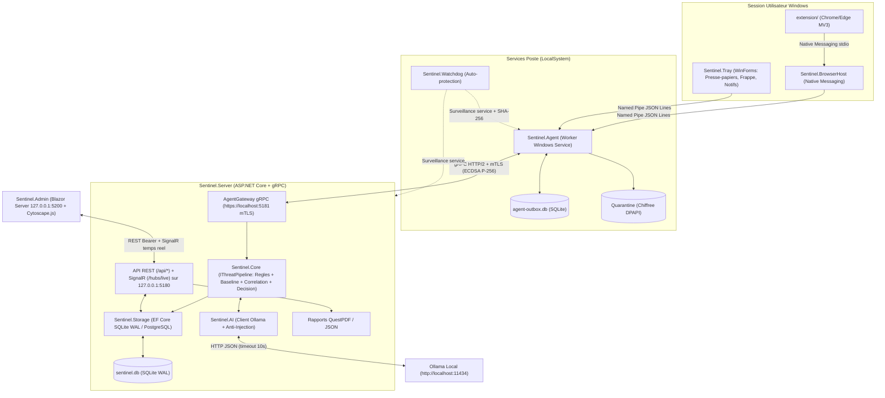
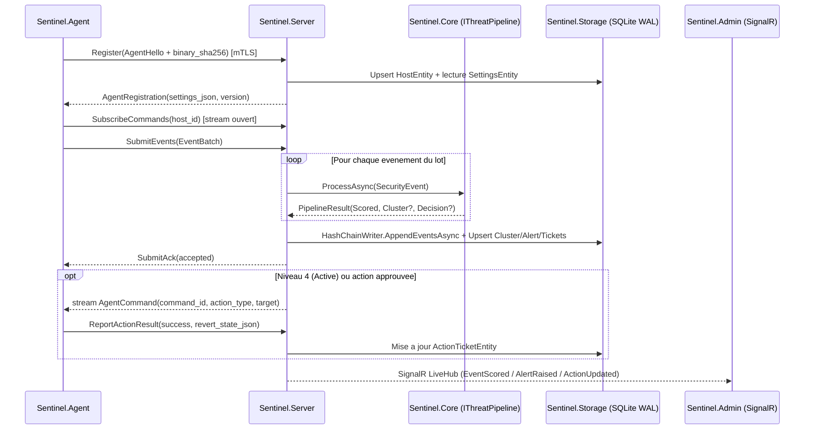
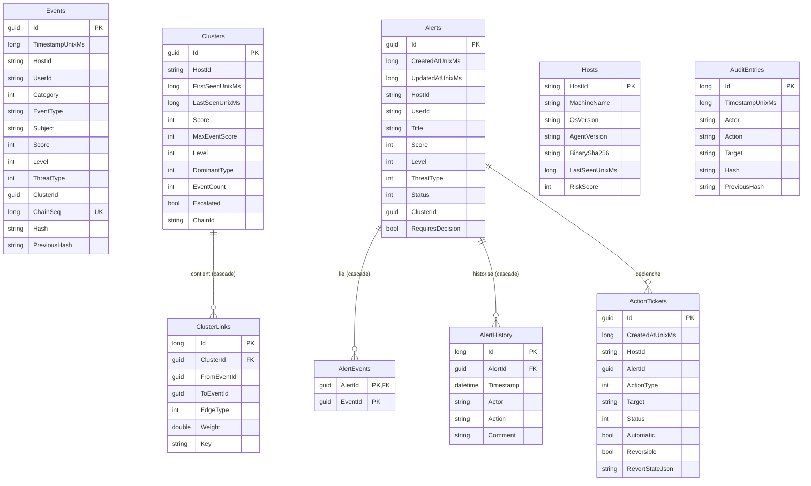

# Architecture technique de SENTINEL

> Référence d'architecture (.NET 10 LTS) — Cohérente avec l'implémentation réelle de la solution `Sentinel.slnx` et les spécifications de conception.

---

## 1. Vue d'ensemble

**SENTINEL** est un système léger de détection et de réponse sur poste de travail (**EDR léger**) orienté vers la détection précoce des **signaux faibles** par corrélation contextuelle. L'ensemble de la plateforme est écrit en **C# / .NET 10 LTS** (hors rendu graphique Cytoscape.js/Chart.js servis en local et extension navigateur Manifest V3) et fonctionne **100 % localement**, sans envoi de télémétrie vers le cloud.

### 1.1 Principes architecturaux

1. **Séparation des privilèges** : la collecte bas niveau et l'exécution d'actions tournent dans un service `LocalSystem` (`Sentinel.Agent`), l'interface utilisateur de session tourne sous le compte utilisateur (`Sentinel.Tray`, `Sentinel.BrowserHost`), l'analyse et la persistance tournent dans `Sentinel.Server`, et la console d'administration (`Sentinel.Admin`) ne dispose d'aucun droit d'exécution système direct.
2. **Résilience hors-ligne** : `Sentinel.Agent` maintient une file locale persistante SQLite (`agent-outbox.db`) qui tamponne les événements en cas d'indisponibilité de `Sentinel.Server`, puis les rejoue par lots dès reconnexion.
3. **Explicabilité et déterminisme** : chaque événement reçoit un score 0–100 accompagné d'une justification, des règles déclenchées et des techniques MITRE ATT&CK. L'IA locale (Ollama) n'est invoquée que sur la bande ambiguë (scores 25–80) et ne déclenche jamais directement d'action.
4. **Intégrité cryptographique** : les événements ingérés (`Events`) et le journal d'audit administrateur (`AuditEntries`) sont protégés par des chaînes de hachage SHA-256 (`H(n) = SHA256(H(n-1) | payload)`).

---

## 2. Diagramme d'architecture globale

### 2.1 Vue Mermaid



### 2.2 Vue ASCII synthétique

```text
┌──────────────────────────── SESSION UTILISATEUR ────────────────────────────┐
│  extension/ (MV3) ──► Sentinel.BrowserHost ──┐                              │
│  Sentinel.Tray (Clipboard, TypingStats, UI) ─┼──► \\.\pipe\Sentinel.Agent.Ipc
└──────────────────────────────────────────────┼──────────────────────────────┘
                                               ▼
┌──────────────────────────── SERVICES WINDOWS ───────────────────────────────┐
│  Sentinel.Agent (LocalSystem) ◄──► Sentinel.Watchdog (Auto-protection)      │
│   ├─ Collecteurs : Process (ETW/WMI), Network, FileSystem, Session, USB,    │
│   │                Installations/Persistance, IPC (Tray + BrowserHost)      │
│   ├─ Outbox locale : %ProgramData%\Sentinel\Outbox\agent-outbox.db          │
│   └─ Exécuteur d'actions réversibles (pare-feu, hosts, quarantaine, PnP)    │
└──────────────────────────────────────────────┬──────────────────────────────┘
                                               │ gRPC HTTP/2 + mTLS (:5181)
                                               ▼
┌──────────────────────────── SENTINEL.SERVER ────────────────────────────────┐
│  AgentGateway (gRPC) ──► Sentinel.Core (IThreatPipeline) ◄──► Sentinel.AI   │
│                            ├─ Pré-filtre & Règles             └─► Ollama    │
│                            ├─ Baseline comportementale            (:11434)  │
│                            ├─ Moteur de corrélation (graphe)                │
│                            └─ Moteur de décision graduée                    │
│  Sentinel.Storage (EF Core SQLite WAL + HashChainWriter + IntegrityVerifier)│
│  API REST + SignalR (/hubs/live) sur http://127.0.0.1:5180                  │
└──────────────────────────────────────────────┬──────────────────────────────┘
                                               │ REST Bearer + SignalR
                                               ▼
┌──────────────────────────── SENTINEL.ADMIN ─────────────────────────────────┐
│  Console Blazor Server (http://127.0.0.1:5200)                              │
│  Vue globale | Alertes | Graphe Cytoscape.js | Fiches | Actions | Audit     │
└─────────────────────────────────────────────────────────────────────────────┘
```

---

## 3. Cartographie des composants

| Composant | Cible / Type | Rôle et responsabilités |
|---|---|---|
| `src/Sentinel.Shared` | `net10.0` (lib) | **Contrat figé** partagé par tous les projets : modèles (`SecurityEvent`, `ThreatAssessment`, `CorrelationCluster`, `ResponseDecision`, `SentinelSettings`, `MitreCatalog`), contrats REST/SignalR (`ApiRoutes`, `Dtos`, `LiveHub`), contrat gRPC (`sentinel.proto`, `ProtoMapper`), protocole IPC (`IpcProtocol`), chemins (`SentinelPaths`, `SentinelEndpoints`), sécurité (`SecretProtector` DPAPI, `HashChain`, `SentinelPki` mTLS). |
| `src/Sentinel.AI` | `net10.0` (lib) | Client HTTP local vers **Ollama** (`localhost:11434`), construction des prompts de scoring avec encadrement des données non fiables, validation stricte du schéma JSON, gestion des timeouts (10 s) et contrôle de concurrence (`MaxConcurrency`). |
| `src/Sentinel.Core` | `net10.0` (lib) | Cœur d'analyse implémentant `IThreatPipeline` : pré-filtre déterministe (listes d'exclusion), moteur de règles, baseline comportementale par poste/utilisateur, orchestration hybride règles + LLM, moteur de corrélation en mémoire (index par clés de contexte, fenêtres glissantes, 7 chaînes d'attaque, escalade précoce) et moteur de décision graduée (matrice type × niveau). |
| `src/Sentinel.Storage` | `net10.0` (lib) | Couche de persistance **EF Core 10** sur SQLite (mode WAL, compatible PostgreSQL) : 14 entités, index sur `TimestampUnixMs`, `SentinelDbInitializer`, `HashChainWriter` (chaînage SHA-256 thread-safe), `IntegrityVerifier`, `RetentionCleaner` et mappers vers DTOs. |
| `src/Sentinel.Server` | `net10.0` (ASP.NET Core + Windows Service) | Service central : expose `AgentGateway` en gRPC mTLS (`:5181`), l'API REST (`/api/*`) et SignalR (`/hubs/live`) en boucle locale (`127.0.0.1:5180`), réhydrate `IThreatPipeline` au démarrage (`WarmUpAsync`), gère l'authentification PBKDF2 + TOTP, l'audit chaîné, les rapports PDF (QuestPDF) et JSON. |
| `src/Sentinel.Agent` | `net10.0-windows` (Worker Service) | Service Windows `LocalSystem` collectant les événements système (ETW `TraceEvent`, WMI, `FileSystemWatcher`, `EventLog`, Registre), hébergeant le serveur Named Pipe, persistant les événements en outbox SQLite, communiquant en gRPC mTLS avec le serveur et exécutant les commandes de réponse réversibles (avec capture de `revert_state_json`). |
| `src/Sentinel.Tray` | `net10.0-windows` (WinForms) | Compagnon de session utilisateur : affiche l'icône de transparence dans la zone de notification, surveille le presse-papiers (`AddClipboardFormatListener`, sans stocker le texte brut), mesure les statistiques inter-touches (`TypingStats` uniquement), affiche les notifications de sensibilisation et exécute `LockWorkStation` sur ordre. |
| `src/Sentinel.BrowserHost` | `net10.0-windows` (Console) | Hôte Native Messaging (Chrome/Edge) traduisant les messages stdio de l'extension navigateur en événements normalisés vers `Sentinel.Agent` via Named Pipe, et relayant en retour les commandes `browser.closeTab` et `browser.blockDomains`. |
| `extension/` | Manifest V3 (Chrome/Edge) | Extension légère collectant les domaines/URLs visités, clics sur liens externes, redirections et démarrages de téléchargement (sans jamais lire le contenu des pages ni des formulaires) et appliquant la fermeture d'onglet / le blocage de domaine en niveau 4. |
| `src/Sentinel.Watchdog` | `net10.0-windows` (Worker Service) | Service indépendant d'auto-protection : vérifie périodiquement l'état des services Windows (`SentinelAgent`, `SentinelServer`) et l'empreinte SHA-256 de leurs binaires, relance automatiquement un service arrêté et émet des événements `AgentTampering` / `IntegrityViolation` (MITRE `T1562`). |
| `src/Sentinel.Admin` | `net10.0` (Blazor Server) | Console d'administration temps réel sur `http://127.0.0.1:5200` (8 écrans : Vue d'ensemble, Alertes, Graphe de corrélation Cytoscape.js, Fiches, Actions & blocages, Rapports, Paramètres, Audit). Zéro dépendance CDN (`cytoscape.min.js` et `chart.umd.js` embarqués dans `wwwroot/lib/`). |
| `src/Sentinel.Installer` | `net10.0-windows` (WinForms) | Installeur guidé présentant l'écran de consentement explicite (persisté dans `consent.json`), générant la PKI mTLS locale, installant et démarrant les services Windows et enregistrant l'hôte Native Messaging de l'extension. |

---

## 4. Flux de communication

### 4.1 Canal Agent ↔ Serveur : gRPC sur HTTP/2 + mTLS

Exposé sur `https://localhost:5181` (configurable). L'authentification est **mutuelle** via `SentinelPki` (CA locale auto-signée ECDSA P-256 générée dans `%ProgramData%\Sentinel\Certs`, clés PFX protégées par un secret DPAPI machine). Le serveur valide que le certificat client est émis par la CA locale (`SentinelPki.ValidateIssuedBy`), et l'agent valide le certificat serveur.

Contrat `sentinel.v1.AgentGateway` (`src/Sentinel.Shared/Protos/sentinel.proto`) :

| RPC | Sens | Fréquence / usage |
|---|---|---|
| `Register(AgentHello) → AgentRegistration` | Agent → Serveur | Au démarrage ; transmet `host_id`, version OS/agent, utilisateurs actifs et `binary_sha256`. Reçoit `settings_json` et `settings_version`. |
| `SubmitEvents(EventBatch) → SubmitAck` | Agent → Serveur | Envoi par lots séquencés (`batch_sequence`) depuis l'outbox SQLite locale ; garantit l'absence de perte en cas de coupure serveur. |
| `Heartbeat(HeartbeatRequest) → HeartbeatReply` | Agent → Serveur | Toutes les 15 s ; remonte CPU %, RAM (`working_set_bytes`), taille de file (`queue_length`) et état des collecteurs. Renvoie `settings_json` uniquement si la version a changé. |
| `SubscribeCommands(CommandSubscription) → stream AgentCommand` | Serveur → Agent | Flux persistant poussant les tickets d'action à exécuter (`revert = false`), simuler (`simulate = true`) ou annuler (`revert = true`, avec `revert_state_json`). |
| `ReportActionResult(ActionResultReport) → Ack` | Agent → Serveur | Retourne le succès/échec d'une commande et le `revert_state_json` capturé avant exécution (ex. nom de règle pare-feu, chemin d'origine d'un fichier mis en quarantaine). |



### 4.2 Canal IPC local : Named Pipe (`\\.\pipe\Sentinel.Agent.Ipc`)

Protocole **JSON Lines** (une trame JSON UTF-8 par ligne, sérialisée via `SentinelJson.Options`) entre `Sentinel.Agent` (serveur Named Pipe) et les processus de session utilisateur (`Sentinel.Tray` et `Sentinel.BrowserHost`).

- **Client → Agent** :
  - `hello` (`IpcHello`) : identification du client (`Tray` ou `BrowserHost`), nom d'utilisateur, `SessionId`, version.
  - `event` (`SecurityEvent`) : événement produit en session utilisateur (`ClipboardUrl`, `ClipboardCommand`, `TypingStats`, `UrlVisited`, `LinkClicked`, `Redirect`, `DownloadStarted`). `HostId` et `UserId` sont complétés par l'agent si absents.
  - `ping` : contrôle de vivacité.
- **Agent → Client** :
  - `welcome` / `settings` (`IpcClientSettings`) : activation des canaux, `OperatingMode`, liste courante des `BlockedDomains`.
  - `notify` (`UserNotification`) : notification discrète ou avertissement de niveau 2 (sensibilisation utilisateur).
  - `browser.closeTab` / `browser.blockDomains` (`BrowserCommand`) : fermeture d'un onglet malveillant ou blocage dynamique de domaines dans l'extension.
  - `session.lock` : verrouillage de la session utilisateur (`LockWorkStation`) exécuté dans le contexte interactif.
  - `pong` : réponse au `ping`.

### 4.3 Canal Serveur ↔ Console Admin : REST + SignalR

- **API REST** sur `http://127.0.0.1:5180/api/*` (boucle locale uniquement) : authentification par jeton Bearer (`Authorization: Bearer <token>`) issu de `POST /api/auth/login` (mot de passe + code TOTP). Seules `/api/auth/status`, `/api/auth/setup` (si non configuré), `/api/auth/login` et `/api/system/ping` sont anonymes.
- **Hub SignalR** sur `/hubs/live` (jeton via `?access_token=`) poussant en temps réel :
  - `EventScored` (`EventDto`, filtré aux événements `Score >= 30` pour limiter le débit),
  - `AlertRaised` / `AlertUpdated` (`AlertDto`),
  - `ClusterUpdated` (`ClusterDto`),
  - `ActionUpdated` (`ActionTicketDto`),
  - `HostStatusChanged` (`HostDto`),
  - `SummaryChanged` (`DashboardSummaryDto`, au plus 1 message toutes les 2 s),
  - `SettingsChanged` (`SentinelSettings`).

---

## 5. Modèle de données et persistance (`Sentinel.Storage`)

### 5.1 Modèle logique partagé

- **`SecurityEvent`** : schéma normalisé commun (`Id`, `Timestamp`, `HostId`, `UserId`, `Category`, `EventType`, `Subject`, `Attributes`, `CorrelationHints`).
- **`ThreatAssessment`** : résultat d'évaluation (`EventId`, `Score` 0–100, `Type`, `Justification`, `Source` Rules/Llm/Hybrid, `Confidence`, `MatchedRules`, `MitreTechniques`).
- **Graphe de corrélation** :
  - Nœuds (`GraphNodeType`) : `Event`, `Process`, `File`, `Domain`, `Ip`, `User`, `Device`, `Threat`, `Host`.
  - Arêtes (`GraphEdgeType`) : `Spawned`, `ConnectedTo`, `Wrote`, `CopiedFromClipboard`, `OpenedUrl`, `SameDomain`, `SameWindow`, `SameAnomalyType`, `SameHash`, `SameEntity`, `InvolvedIn`, `Sequence`.

### 5.2 Schéma relationnel EF Core (14 tables)

La base SQLite (`%ProgramData%\Sentinel\Data\sentinel.db`, compatible PostgreSQL sans colonne spécifique SQLite) fonctionne en mode **WAL** (`PRAGMA journal_mode=WAL; synchronous=NORMAL; foreign_keys=ON; busy_timeout=5000`). Toutes les tables horodatées possèdent une colonne entière `*UnixMs` indexée afin d'éviter les limites de tri/comparaison de `DateTimeOffset` en LINQ sur SQLite.



Tables de configuration, authentification et évaluation complémentaires :
- `Settings` (`Id = 1`, `Version`, `SettingsJson`, `UpdatedAt`)
- `BaselineSnapshots` (`Id = 1`, `SnapshotJson`, `UpdatedAt`)
- `AdminUsers` (`Id = 1`, `Username`, `PasswordHash` PBKDF2, `PasswordSalt`, `TotpSecretProtected` DPAPI, `TotpConfirmed`)
- `AdminSessions` (`TokenHash` PK SHA-256, `Username`, `CreatedAt`, `ExpiresAt`, `IpAddress`, `Revoked`)
- `EvaluationMetrics` (`Id`, `RunAt`, `Scenario`, `Configuration`, `Detected`, `EventsBeforeAlert`, `SecondsToDetect`, `PeakScore`, `FalsePositives`)

### 5.3 Chaînes d'intégrité et rétention

- **`HashChainWriter`** : sérialise via `SemaphoreSlim` les insertions dans `Events` (assignation de `ChainSeq` strictement contigu + calcul SHA-256) et dans `AuditEntries`. Les charges utiles `ComputeEventPayload` et `ComputeAuditPayload` utilisent un format canonique échappé et indépendant de la culture (`CultureInfo.InvariantCulture`).
- **`IntegrityVerifier`** : parcourt les deux tables en streaming (`AsAsyncEnumerable`, mémoire $O(1)$) et retourne `IntegrityReportDto[]` pour `GET /api/audit/verify`.
- **`RetentionCleaner`** : purge les événements de plus de `EventRetentionDays` (90 j par défaut), les clusters anciens non référencés par une alerte, les alertes de plus de `AlertRetentionDays` (365 j par défaut) et les sessions administrateur expirées/révoquées. Les `AuditEntries` ne sont jamais purgées automatiquement.

---

## 6. Organisation des fichiers sur disque

Racine contrôlée par `SentinelPaths` : variable d'environnement `SENTINEL_DATA_DIR` (développement / tests), sinon `%ProgramData%\Sentinel`.

| Dossier / Fichier | Contenu | Protection |
|---|---|---|
| `Data/sentinel.db` (+ `-wal`, `-shm`) | Base SQLite principale de `Sentinel.Server` | ACL Windows `SYSTEM` / `Administrators` |
| `Data/consent.json` | Preuve horodatée du consentement d'installation | Lecture seule utilisateur |
| `Data/agent-state.json` | État local persistant de l'agent | ACL `SYSTEM` |
| `Outbox/agent-outbox.db` | File d'attente locale SQLite de l'agent | ACL `SYSTEM` |
| `Certs/` | `sentinel-ca.pfx`, `sentinel-ca.cer`, `sentinel-server.pfx`, `sentinel-agent.pfx` | PFX chiffrés par secret DPAPI |
| `Secrets/` | Clés aléatoires (`pki-password.dpapi`, etc.) | DPAPI (`LocalMachine`) |
| `Quarantine/` | Fichiers mis en quarantaine réversible | Chiffrés au repos, non exécutables |
| `Logs/` | Journaux techniques Serilog (rotation quotidienne) | Sans données personnelles sensibles |
| `Reports/` | Rapports PDF / JSON exportés | Accès administrateur |
