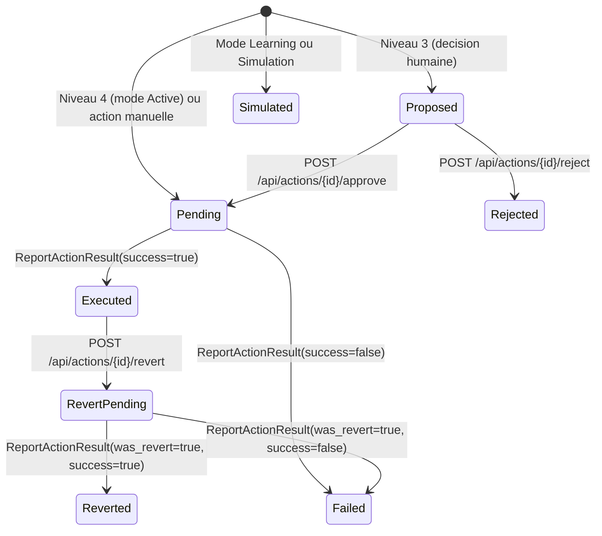

# Matrice de décision graduée et réversibilité

> Spécification du moteur de décision déterministe de **SENTINEL** (cohérente avec la section §9 de `SENTINEL_Documentation.md`, `ThreatLevel`, `ResponseActionType`, `ActionStatus` et `SentinelSettings`).

---

## 1. Principe de décision déterministe

Dans SENTINEL, le moteur de décision (`Sentinel.Core`) est **strictement déterministe** :
- Le LLM local (Ollama) ne déclenche **jamais** une action directement ; il contribue uniquement au score et à la justification.
- L'entrée du moteur de décision est le score effectif (`max(score_événement, score_cluster)`), le niveau résultant (éventuellement relevé par l'escalade précoce), le type de menace (`ThreatType`) et le mode de fonctionnement courant (`OperatingMode`).
- Chaque décision produit un objet `ResponseDecision` entièrement justifié (`Justification`, `Actions`, `RequiresHumanApproval`, `AlertAdmin`, `NotifyUser`, `Mode`).

---

## 2. Échelle des niveaux de menace (0 à 4)

Les seuils par défaut (`ThreatThresholds`) sont configurables depuis l'écran **Paramètres** (`PUT /api/settings`) :

| Niveau (`ThreatLevel`) | Valeur | Plage de score par défaut | Libellé | Mode de décision | Effet principal |
|---|---|---|---|---|---|
| `Info` | 0 | **0 – 29** | Info | Automatique passif | Journalisation seule (`LogOnly`) |
| `Low` | 1 | **30 – 54** | Faible | Automatique passif | Journalisation + marquage pour le moteur de corrélation (`MarkForCorrelation`) |
| `Moderate` | 2 | **55 – 74** | Modéré | Semi-passif | Notification discrète à l'utilisateur (`NotifyUser`) + surveillance renforcée (`EnhancedMonitoring`) |
| `High` | 3 | **75 – 89** | Élevé | **Décision humaine requise** | Alerte administrateur (`AlertAdmin`), actions créées au statut **`Proposed`** en attente d'approbation (`RequiresHumanApproval = true`) |
| `Critical` | 4 | **90 – 100** | Critique | **Blocage automatique réversible** | Alerte critique immédiate + exécution automatique réversible (`Pending` → `Executed` en mode `Active`) |

---

## 3. Matrice complète des actions (Type de menace × Niveau)

Les identifiants entre backticks correspondent exactement à l'énumération `ResponseActionType` (`src/Sentinel.Shared/Models/Enums.cs`).

| Type de menace (`ThreatType`) | Niveau 1–2 (Faible / Modéré) | Niveau 3 — Élevé *(décision humaine : `Proposed`)* | Niveau 4 — Critique *(automatique réversible en mode `Active`)* |
|---|---|---|---|
| **Phishing** (`Phishing`) | `LogOnly`, `MarkForCorrelation`, `NotifyUser` (avertissement lien suspect) | `AlertAdmin` + proposition `BlockDomain` | `BlockDomain` (règle hosts/pare-feu + extension) + `CloseBrowserTab` (via `Sentinel.BrowserHost`) |
| **Malware / Exécutable malveillant** (`Malware`) | `LogOnly`, `WatchHash` (mise en surveillance du SHA-256) | `AlertAdmin` + proposition `SuspendProcess` | `KillProcess` + `QuarantineFile` (déplacement chiffré réversible) |
| **Ransomware** (`Ransomware`) | `EnhancedMonitoring` (surveillance accrue des dossiers) | `AlertAdmin` + proposition `SuspendProcess` | `KillProcess` + `IsolateNetwork` + `ProtectFolders` (verrouillage écriture dossiers sensibles) |
| **BadUSB / Périphérique** (`BadUsb`) | `LogOnly`, `EnhancedMonitoring` | `AlertAdmin` + proposition `DisableDevice` | `DisableDevice` (désactivation PnP du périphérique HID/USB suspect) |
| **Exfiltration** (`Exfiltration`) | `LogOnly`, `EnhancedMonitoring` | `AlertAdmin` + proposition `ThrottleTraffic` | `BlockProcessConnections` (règle pare-feu bloquant les connexions sortantes du processus) |
| **Intrusion / Brute force** (`Intrusion`) | `LogOnly`, `MarkForCorrelation` | `AlertAdmin` + proposition `LockSession` | `LockAccount` (ou `LockSession`) + `BlockIp` (règle pare-feu bloquant l'IP source) |
| **Ingénierie sociale** (`SocialEngineering`) | `UserAwareness` (message pédagogique à l'utilisateur via `Sentinel.Tray`) | `AlertAdmin` + proposition `BlockDomain` + rapport | `BlockDomain` (domaines liés) + `CloseBrowserTab` + escalade critique |
| **Persistance** (`Persistence`) | `LogOnly`, `EnhancedMonitoring` | `AlertAdmin` + proposition `WatchHash` / `QuarantineFile` | `QuarantineFile` (binaire/script ciblé par la tâche/clé) + `AlertAdmin` |
| **Anomalie comportementale** (`Anomaly`) | `LogOnly`, `NotifyUser` | `AlertAdmin` + revue humaine | `LockSession` (verrouillage interactif via `Sentinel.Tray`) |
| **Auto-protection / Altération** (`Tampering`) | `AlertAdmin` (immédiat) | `AlertAdmin` + vérification d'intégrité (`IntegrityVerifier`) | `AlertAdmin` critique + relance automatique par `Sentinel.Watchdog` |

---

## 4. Ticket d'action et réversibilité en 1 clic (Exigence F7)

### 4.1 Cycle de vie d'un ticket (`ActionTicketEntity` / `ActionStatus`)

### 4.2 Mécanisme de réversibilité

Avant toute modification système, l'exécuteur d'actions de `Sentinel.Agent` capture l'état initial dans `revert_state_json` et le retourne au serveur via `ReportActionResult` (`ActionTicketEntity.RevertStateJson`).

| Action exécutée | Effet système | État stocké dans `RevertStateJson` | Effet du clic « Annuler » (`POST /api/actions/{id}/revert`) |
|---|---|---|---|
| `QuarantineFile` | Déplacement + chiffrement vers `%ProgramData%\Sentinel\Quarantine\<id>.sqf` | Chemin d'origine, hash SHA-256, ACL/horodatages, nom du fichier en quarantaine | Déchiffrement, vérification SHA-256 et restauration à l'emplacement exact d'origine |
| `BlockDomain` | Entrée taguée dans le fichier `hosts` + blocage extension (`browser.blockDomains`) | Domaine bloqué, lignes ajoutées dans `hosts` | Suppression des lignes taguées SENTINEL dans `hosts` + retrait de la liste extension |
| `BlockIp` / `BlockProcessConnections` | Création d'une règle Pare-feu Windows nommée `Sentinel-Block-<id>` | Nom exact de la règle pare-feu | Suppression propre de la règle `Sentinel-Block-<id>` |
| `IsolateNetwork` | Règles Pare-feu Windows isolant le trafic hors `127.0.0.1` / serveur SENTINEL | Liste des règles créées | Suppression des règles d'isolation et rétablissement réseau complet |
| `DisableDevice` | Désactivation du périphérique PnP (`pnputil` / WMI) | Identifiant d'instance PnP (`DeviceId`) | Réactivation PnP du périphérique |
| `SuspendProcess` | Suspension des threads du processus (`NtSuspendProcess`) | PID + nom + heure de démarrage du processus | Reprise (`NtResumeProcess`) si le processus est toujours vivant |
| `ProtectFolders` | Ajout d'ACL de déni temporaire d'écriture | Chemins des dossiers + ACE ajoutées | Retrait des ACE temporaires |
| `LockAccount` | Désactivation / verrouillage temporaire du compte local | Nom du compte et état antérieur | Réactivation / déverrouillage du compte |

> **Règle de sûreté absolue** : les actions destructives irréversibles (suppression définitive d'un fichier, formatage, effacement de profil) sont **strictement interdites** en exécution automatique. Pour `KillProcess`, le fichier binaire associé reste intact (ou est mis en quarantaine réversible) afin que l'utilisateur puisse relancer le programme après annulation.

---

## 5. Mécanismes anti-faux-positifs

Pour éviter qu'un faux positif ne perturbe l'activité légitime de l'utilisateur (§9.4 de la conception), quatre garde-fous complémentaires sont intégrés :

1. **Mode Apprentissage (`OperatingMode.Learning`) — 7 jours par défaut** :
   - Activé par défaut à la première installation (`LearningPeriodDays = 7`, `LearningStartedAt`).
   - Construit la **baseline comportementale** de chaque poste/utilisateur (heures habituelles, processus fréquents, domaines courants, cadence moyenne de frappe).
   - **Aucune action de blocage n'est exécutée** : les décisions de niveau 4 sont enregistrées au statut `Simulated` à titre d'observation.
   - Si `AutoLeaveLearning = true`, la bascule vers `OperatingMode.Active` s'effectue automatiquement à l'issue des 7 jours (modifiable à tout moment depuis les Paramètres).
2. **Mode Simulation (`OperatingMode.Simulation`)** :
   - Permet de tester de nouveaux seuils ou règles sur un poste réel sans risque : `AgentCommand.Simulate = true`, les actions sont validées et journalisées comme `Simulated`, sans aucun impact système.
3. **Listes d'exclusions configurables (`SentinelSettings`)** :
   - `ExcludedProcesses` : processus système et binaires de sécurité protégés par défaut (`MsMpEng.exe`, `svchost.exe`, `SearchIndexer.exe`, `Sentinel.Agent.exe`, `Sentinel.Server.exe`).
   - `ExcludedDomains`, `ExcludedHashes`, `ExcludedPaths` : personnalisables par l'administrateur.
4. **Boucle de rétroaction administrateur (`AnalystFeedback`)** :
   - Lorsqu'une alerte est rejetée comme **faux positif** (`POST /api/alerts/{id}/reject` → `AlertStatus.FalsePositive`), `Sentinel.Server` invoque `IThreatPipeline.ApplyFeedback(feedback)`.
   - Les entités impliquées (processus/hash/domaine) sont réinjectées dans la baseline et les exclusions apprises afin de réduire durablement les faux positifs récurrents.
